# المشاكل المكتشفة

العدد: **29** مشكلة: حرجة 2، عالية 4، متوسطة 10، منخفضة 13.

**التصنيف:** حرجة = تمنع إتمام المهمة أو الإطلاق. عالية = تؤثر بشدة على التجربة. متوسطة = صعوبة أو ارتباك. منخفضة = تحسين شكلي أو تفصيلي.

كل مشكلة هنا شوهدت أو قيست فعلاً بأداة أو اختبار مذكور في «المصدر». الاقتراحات التصميمية التي ليست مشاكل في قسم منفصل آخر الملف.

| # | الخطورة | الصفحة | المشكلة |
|---|---|---|---|
| [UX-01](#ux-01) | حرجة | لوحة الكول سنتر | لوحة الموظفين مفتوحة بلا تسجيل دخول |
| [UX-02](#ux-02) | حرجة | كل الصفحات | الطلبات لا تصل للمطعم |
| [UX-03](#ux-03) | عالية | المنيو | المنيو على الموبايل بطيء في الشبكات الضعيفة |
| [UX-04](#ux-04) | عالية | المنيو | زر الرجوع يخرج من المنيو بدل قفل نافذة الصنف |
| [UX-05](#ux-05) | عالية | صفحة الطلب / إتمام الطلب | إعادة الطلب تبدأ من الصفر |
| [UX-06](#ux-06) | عالية | الرئيسية / إتمام الطلب / التأكيد | لا يوجد وقت توصيل متوقع ولا حد أدنى للطلب |
| [UX-07](#ux-07) | متوسطة | المنيو | البحث لا يفهم المرادفات |
| [UX-08](#ux-08) | متوسطة | نافذة الصنف | الأحجام بلا وزن أو عدد أفراد |
| [UX-09](#ux-09) | متوسطة | نافذة الصنف | أصناف بلا وصف تشرح المصطلحات المحلية |
| [UX-10](#ux-10) | متوسطة | المنيو | لا أسعار على الكروت |
| [UX-11](#ux-11) | متوسطة | إتمام الطلب | الضريبة تظهر لأول مرة في صفحة الدفع |
| [UX-12](#ux-12) | متوسطة | إتمام الطلب | الحقول بلا حدود ظاهرة وعناوينها صغيرة |
| [UX-13](#ux-13) | متوسطة | الرئيسية | اسم الفرع يُقص على شاشة 360 |
| [UX-14](#ux-14) | متوسطة | المنيو | لا يوجد رابط تخطٍّ؛ 20 ضغطة Tab للوصول لأول صنف |
| [UX-15](#ux-15) | متوسطة | المنيو / السلة | اسم الزر المقروء لا يطابق النص الظاهر |
| [UX-16](#ux-16) | متوسطة | إتمام الطلب / الطلب / التتبع | صفحات بلا منطقة main وشريط تجريبي خارج المناطق |
| [UX-17](#ux-17) | منخفضة | إتمام الطلب | ضغطة Tab بعد حقل المنطقة تضيع |
| [UX-18](#ux-18) | منخفضة | لوحة الكول سنتر | اللوحة تفتح على «جديد» فتختفي الطلبات الجارية |
| [UX-19](#ux-19) | منخفضة | لوحة الكول سنتر | التاريخ يظهر بالصيغة الأمريكية |
| [UX-20](#ux-20) | منخفضة | المنيو | إطار التركيز على الكارت باهت |
| [UX-21](#ux-21) | منخفضة | صفحة الطلب / نافذة الصنف / المنيو | أزرار أصغر من 44 بكسل |
| [UX-22](#ux-22) | منخفضة | عدة صفحات | نصوص بحجم 11 إلى 11.5 بكسل |
| [UX-23](#ux-23) | منخفضة | المنيو | رسالة الإضافة بخط النظام لا بخط الموقع |
| [UX-24](#ux-24) | منخفضة | إتمام الطلب / الطلب / التتبع | الخلفية المتدرجة بلا لون احتياطي |
| [UX-25](#ux-25) | منخفضة | لوحة الكول سنتر | قفزة تخطيط في اللوحة على الموبايل |
| [UX-26](#ux-26) | منخفضة | اللوحة / 404 | صور لوجو أكبر بكثير من حجم عرضها |
| [UX-27](#ux-27) | منخفضة | الرئيسية وغيرها | مساحات فارغة كبيرة على شاشات 1920 |
| [UX-28](#ux-28) | منخفضة | الرئيسية | عنوان فرع التجمع مقصوص في كل المقاسات |
| [UX-29](#ux-29) | منخفضة | السلة / إتمام الطلب | لا يمكن الطلب المسبق والفرع مغلق |

## حرجة

### UX-01
**لوحة الموظفين مفتوحة بلا تسجيل دخول**

- **الصفحة:** لوحة الكول سنتر
- **العنصر:** /admin و/admin/zones
- **الوصف:** أي شخص يعرف الرابط يرى أسماء العملاء وأرقامهم وعناوينهم، ويغيّر حالة الطلبات ويلغيها ويضيف مناطق ويحذفها.
- **الدليل:** اختبار F45 فشل كما هو متوقع: لا توجد شاشة دخول؛ اللوحة تعرض بيانات 3 عملاء تجريبيين مباشرة.
- **لقطة الشاشة:** `screenshots/evidence/admin-no-signin.jpg`
- **السبب المحتمل:** النسخة الحالية تجريبية؛ تسجيل الدخول مخطط مع ربط Supabase ولم يُنفّذ.
- **التأثير على المستخدم:** تسريب بيانات العملاء وإمكانية تخريب الطلبات بمجرد نشر الرابط.
- **الحل المقترح:** تسجيل دخول للموظفين (Supabase Auth) وحماية المسارين قبل أي نشر حقيقي.
- **الأولوية:** حرجة
- **المصدر:** اختبار وظيفي F45

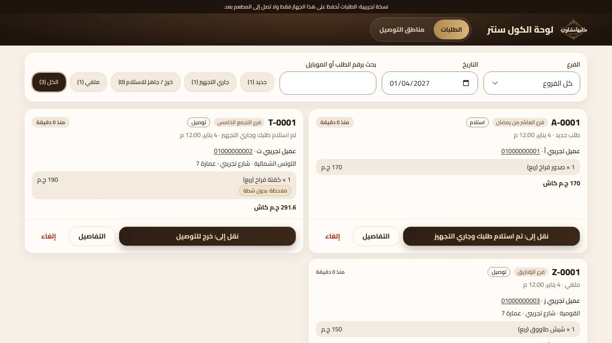

### UX-02
**الطلبات لا تصل للمطعم**

- **الصفحة:** كل الصفحات
- **العنصر:** إرسال الطلب
- **الوصف:** الطلب يُحفظ في متصفح العميل فقط. الشريط العلوي يقول ذلك صراحة. لا خلفية ولا إشعار للمطعم.
- **الدليل:** الشريط «نسخة تجريبية: الطلبات تُحفظ على هذا الجهاز فقط» ظاهر في كل الصفحات (اختبار F46). الطلب الذي يُنشأ في تبويب يظهر في لوحة التبويب الآخر على نفس الجهاز فقط (F42).
- **لقطة الشاشة:** `screenshots/m390/home.jpg`
- **السبب المحتمل:** الواجهة تعمل بخلفية تجريبية محلية (localStorage) بانتظار حساب Supabase.
- **التأثير على المستخدم:** الموقع غير صالح للاستخدام الحقيقي: العميل يظن أنه طلب ولا يصل شيء.
- **الحل المقترح:** ربط قاعدة البيانات الجاهزة (Supabase) وإشعار Telegram قبل الإطلاق.
- **الأولوية:** حرجة
- **المصدر:** اختبار وظيفي F42 وF46

## عالية

### UX-03
**المنيو على الموبايل بطيء في الشبكات الضعيفة**

- **الصفحة:** المنيو
- **العنصر:** صور الكروت
- **الوصف:** في محاكاة 4G بطيئة يظهر أكبر عنصر بعد 5.4 إلى 5.6 ثانية، لأن المتصفح يحمّل 27 صورة (586 KB) عند فتح المنيو.
- **الدليل:** Lighthouse موبايل: العاشر 76، التجمع 79؛ Unlighthouse: 79 إلى 80 للمنيوهات الثلاثة. حجم الصفحة 950 KB.
- **لقطة الشاشة:** `screenshots/evidence/menu-mobile-heavy.jpg`
- **السبب المحتمل:** التحميل الكسول الأصلي في Chrome يبدأ قبل الصورة بمسافة كبيرة على الشبكات البطيئة، فتُطلب صور كثيرة خارج الشاشة.
- **التأثير على المستخدم:** العميل على باقة ضعيفة ينتظر 5 ثوانٍ قبل رؤية الأصناف، وقد يغادر.
- **الحل المقترح:** تحميل الصور بـ IntersectionObserver بهامش صغير، وصور مصغرة 300 بكسل بصيغة AVIF، وأول 4 صور فقط بأولوية.
- **الأولوية:** عالية
- **المصدر:** Lighthouse وUnlighthouse

### UX-04
**زر الرجوع يخرج من المنيو بدل قفل نافذة الصنف**

- **الصفحة:** المنيو
- **العنصر:** زر الرجوع في التليفون
- **الوصف:** عند فتح صنف ثم الضغط على رجوع التليفون، يرجع المستخدم للصفحة الرئيسية بدل قفل النافذة.
- **الدليل:** اختبار F20 فشل: العنوان بعد الرجوع «/». الشخصية 4 (مستخدم الموبايل) فشلت في المهمة.
- **لقطة الشاشة:** `screenshots/evidence/back-button-left-menu.jpg`
- **السبب المحتمل:** فتح النوافذ لا يُسجَّل في سجل المتصفح.
- **التأثير على المستخدم:** أكثر حركة شائعة على أندرويد تُخرج العميل من المنيو؛ السلة محفوظة لكن السياق يضيع.
- **الحل المقترح:** إضافة حالة في السجل عند فتح النافذة (history.pushState) وقفلها عند popstate.
- **الأولوية:** عالية
- **المصدر:** اختبار F20 والشخصية 4

### UX-05
**إعادة الطلب تبدأ من الصفر**

- **الصفحة:** صفحة الطلب / إتمام الطلب
- **العنصر:** «اطلب مرة أخرى» وبيانات العميل
- **الوصف:** «اطلب مرة أخرى» يفتح المنيو فقط والسلة فارغة، والاسم والرقم يُمسحان بعد كل طلب فيكتبهما العميل كل مرة.
- **الدليل:** الشخصية 3: «فتح المنيو والسلة فارغة»، و«الاسم المحفوظ: (فارغ)». المهمة احتاجت 8 نقرات بدل نقرتين.
- **لقطة الشاشة:** `screenshots/evidence/reorder-empty-cart.jpg`
- **السبب المحتمل:** الزر رابط للمنيو، ومسودة البيانات تُمسح بعد نجاح الطلب (قرار سابق).
- **التأثير على المستخدم:** العميل المتكرر هو الأهم للمطعم، وهو الأكثر تضرراً.
- **الحل المقترح:** «اطلب مرة أخرى» يملأ السلة بنفس الأصناف، وتذكّر الاسم والرقم والعنوان على نفس الجهاز (بموافقة المالك).
- **الأولوية:** عالية
- **المصدر:** الشخصية 3

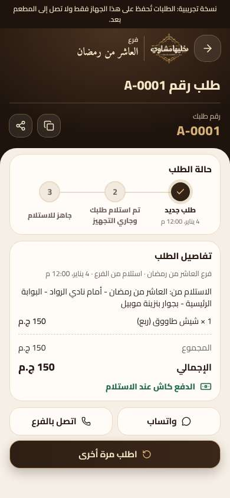

### UX-06
**لا يوجد وقت توصيل متوقع ولا حد أدنى للطلب**

- **الصفحة:** الرئيسية / إتمام الطلب / التأكيد
- **العنصر:** معلومات التوصيل
- **الوصف:** العميل لا يعرف متى يصل طلبه قبل التأكيد ولا بعده، ولا هل يوجد حد أدنى.
- **الدليل:** الشخصية 5: «حد أدنى: غير مذكور، وقت التوصيل: غير مذكور». الشخصية 1 بعد التأكيد: لا يعرف هل سيتصل الفرع.
- **لقطة الشاشة:** `screenshots/evidence/no-eta-after-order.jpg`
- **السبب المحتمل:** المعلومة غير متوفرة من المالك بعد.
- **التأثير على المستخدم:** أهم سؤال قبل الدفع؛ غيابه يزيد التردد ومكالمات «فين طلبي».
- **الحل المقترح:** نص لكل فرع: «التوصيل خلال 45 إلى 60 دقيقة» في كارت الفرع وفي صفحة التأكيد، وجملة «سيتصل بك الفرع لتأكيد الطلب».
- **الأولوية:** عالية
- **المصدر:** الشخصيتان 1 و5

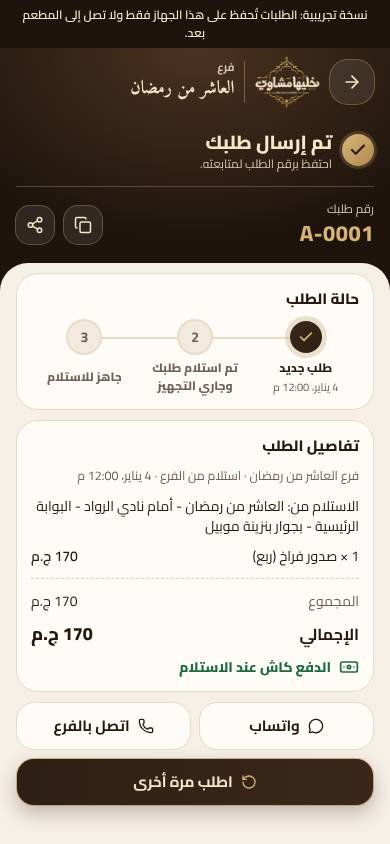

## متوسطة

### UX-07
**البحث لا يفهم المرادفات**

- **الصفحة:** المنيو
- **العنصر:** خانة البحث
- **الوصف:** كلمة «دجاج» تعطي صنفاً واحداً، بينما كل أصناف الفراخ مكتوبة «فراخ»، و«فراخ» لا تجد «فرخة».
- **الدليل:** اختبار F10 فشل. الشخصية 6: «دجاج» = نتيجة واحدة، «فراخ» = 4 نتائج.
- **لقطة الشاشة:** `screenshots/evidence/search-dajaj.jpg`
- **السبب المحتمل:** البحث يطابق النص حرفياً مع توحيد الهمزات فقط.
- **التأثير على المستخدم:** زائر من خارج المنطقة لا يجد ما يريد ويظن أن الصنف غير موجود.
- **الحل المقترح:** قائمة مرادفات صغيرة (دجاج=فراخ=فرخة، لحم=لحمة، رز=أرز، كفته=كفتة).
- **الأولوية:** متوسطة
- **المصدر:** اختبار F10 والشخصية 6

### UX-08
**الأحجام بلا وزن أو عدد أفراد**

- **الصفحة:** نافذة الصنف
- **العنصر:** الأحجام
- **الوصف:** «ربع/تلت/نص/كيلو» دون توضيح أنها من الكيلو، ولا كم شخصاً تكفي.
- **الدليل:** الشخصيتان 1 و6 توقفتا عند الأحجام. الأحجام المعروضة: «ربع 170 ج.م | تلت 235 ج.م | نص 340 ج.م | كيلو 680 ج.م».
- **لقطة الشاشة:** `screenshots/evidence/sizes-no-weight.jpg`
- **السبب المحتمل:** المنيو المطبوع بنفس الصيغة.
- **التأثير على المستخدم:** تردد في الاختيار، وطلبات أقل أو أكثر من المطلوب.
- **الحل المقترح:** سطر صغير تحت كل حجم: «ربع كيلو · يكفي فرداً».
- **الأولوية:** متوسطة
- **المصدر:** الشخصيتان 1 و6

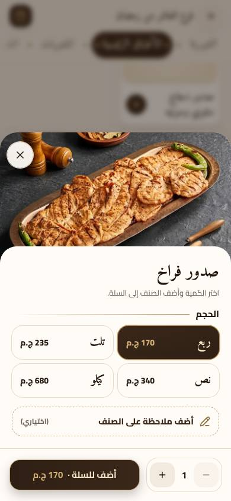

### UX-09
**أصناف بلا وصف تشرح المصطلحات المحلية**

- **الصفحة:** نافذة الصنف
- **العنصر:** وصف الصنف
- **الوصف:** «مسحب» و«طاسة» و«برام» بلا وصف؛ النافذة تكتب نصاً عاماً «اختر الكمية وأضف الصنف إلى السلة».
- **الدليل:** الشخصية 6: وصف «فرخة مسحب» = «اختر الكمية وأضف الصنف إلى السلة.»
- **لقطة الشاشة:** `screenshots/evidence/no-item-description.jpg`
- **السبب المحتمل:** ملف المنيو يحتوي وصفاً لأصناف قليلة فقط.
- **التأثير على المستخدم:** من لا يعرف المصطلح لا يطلبه.
- **الحل المقترح:** وصف من سطر واحد لكل صنف (ما هو، المكونات).
- **الأولوية:** متوسطة
- **المصدر:** الشخصية 6

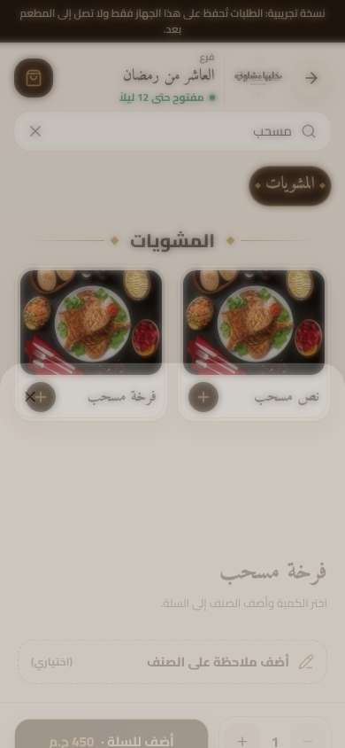

### UX-10
**لا أسعار على الكروت**

- **الصفحة:** المنيو
- **العنصر:** كروت الأصناف
- **الوصف:** لمعرفة سعر أي صنف يجب فتحه؛ مقارنة 3 أصناف = 6 نقرات.
- **الدليل:** الشخصية 5: «عدد الأسعار الظاهرة على المنيو: 0».
- **لقطة الشاشة:** `screenshots/evidence/no-prices-on-cards.jpg`
- **السبب المحتمل:** قرار تصميم سابق من المالك.
- **التأثير على المستخدم:** بطء في الاختيار، والعميل المعتاد على تطبيقات التوصيل يتوقع رؤية السعر.
- **الحل المقترح:** سطر «يبدأ من 170 ج.م» صغير تحت الاسم (يحتاج موافقة المالك).
- **الأولوية:** متوسطة
- **المصدر:** الشخصية 5

### UX-11
**الضريبة تظهر لأول مرة في صفحة الدفع**

- **الصفحة:** إتمام الطلب
- **العنصر:** ضريبة 14٪ (التجمع)
- **الوصف:** في فرع التجمع تُضاف 14٪ ولا يُذكر ذلك في المنيو أو السلة.
- **الدليل:** الشخصية 1: «الإجمالي 285 ج.م، وسطر ضريبة 14٪ ظاهر» لأول مرة في إتمام الطلب لصنف سعره 250.
- **لقطة الشاشة:** `screenshots/evidence/tax-first-at-checkout.jpg`
- **السبب المحتمل:** الضريبة تُحسب في الإتمام فقط.
- **التأثير على المستخدم:** مفاجأة في السعر في آخر خطوة = سبب شائع لترك الطلب.
- **الحل المقترح:** سطر «الأسعار لا تشمل ضريبة 14٪» في رأس منيو التجمع وفي السلة.
- **الأولوية:** متوسطة
- **المصدر:** الشخصية 1

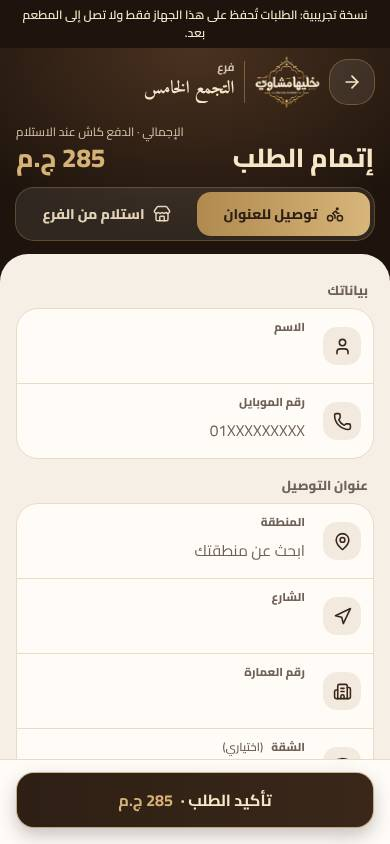

### UX-12
**الحقول بلا حدود ظاهرة وعناوينها صغيرة**

- **الصفحة:** إتمام الطلب
- **العنصر:** حقول النموذج
- **الوصف:** حقول الاسم والشارع والعمارة تظهر كمساحة بيضاء داخل صف، بلا إطار للكتابة، وعناوينها 11.5 بكسل.
- **الدليل:** لقطة 1366: صف «الاسم» فارغ تماماً دون نص إرشادي. الفحص: 11 عنصراً نصياً بحجم 11 إلى 11.5 بكسل.
- **لقطة الشاشة:** `screenshots/evidence/checkout-fields-affordance.jpg`
- **السبب المحتمل:** تصميم الحقول بأسلوب «صف بأيقونة» بلا حد للحقل.
- **التأثير على المستخدم:** المستخدم قليل الخبرة لا يعرف أين يكتب، وكبار السن يجدون العناوين صغيرة.
- **الحل المقترح:** إطار خفيف أو خلفية للحقل عند عدم التركيز، وعناوين 13 بكسل على الأقل.
- **الأولوية:** متوسطة
- **المصدر:** الفحص البصري

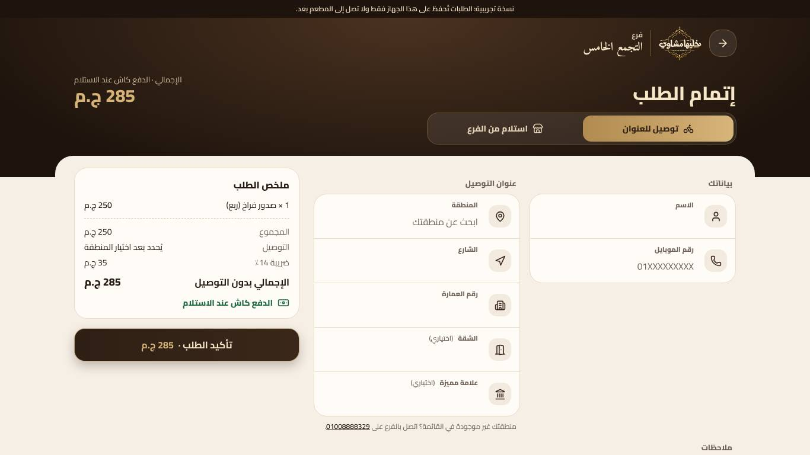

### UX-13
**اسم الفرع يُقص على شاشة 360**

- **الصفحة:** الرئيسية
- **العنصر:** اسم الفرع
- **الوصف:** «فرع العاشر من رمضان» يظهر «فرع العاشر من رم…» على الشاشات الصغيرة.
- **الدليل:** مقياس النص المقصوص على 360: «فرع العاشر من رمضان» و«فرع التجمع الخامس» (في الحالة المغلقة).
- **لقطة الشاشة:** `screenshots/evidence/branch-name-truncated-360.jpg`
- **السبب المحتمل:** الاسم وشارة الحالة في سطر واحد بعرض ثابت.
- **التأثير على المستخدم:** اسم الفرع هو أساس الاختيار؛ قصه يربك على الهواتف الصغيرة الشائعة.
- **الحل المقترح:** السماح للاسم بسطرين أو نقل الشارة تحته تحت 380 بكسل.
- **الأولوية:** متوسطة
- **المصدر:** الفحص البصري الآلي

### UX-14
**لا يوجد رابط تخطٍّ؛ 20 ضغطة Tab للوصول لأول صنف**

- **الصفحة:** المنيو
- **العنصر:** التنقل بلوحة المفاتيح
- **الوصف:** مستخدم لوحة المفاتيح يمر على كل الأقسام الـ16 قبل أول صنف، ولا يوجد «انتقل إلى المحتوى» في أي صفحة.
- **الدليل:** اختبار لوحة المفاتيح: المنيو 20 ضغطة لأول صنف، لا رابط تخطٍّ في 5 صفحات.
- **لقطة الشاشة:** لا توجد (نتيجة اختبار لوحة المفاتيح أو قياس)، انظر `results/`
- **السبب المحتمل:** غياب رابط تخطٍّ.
- **التأثير على المستخدم:** بطء شديد لمستخدمي لوحة المفاتيح وقارئات الشاشة.
- **الحل المقترح:** رابط «انتقل إلى الأصناف» مخفي يظهر عند التركيز.
- **الأولوية:** متوسطة
- **المصدر:** اختبار لوحة المفاتيح

### UX-15
**اسم الزر المقروء لا يطابق النص الظاهر**

- **الصفحة:** المنيو / السلة
- **العنصر:** زر السلة وشريط السلة
- **الوصف:** زر السلة في الهيدر اسمه «السلة (1)» ونصه الظاهر رقم فقط، وشريط السلة اسمه مختلف الترتيب عن نصه.
- **الدليل:** axe: label-content-name-mismatch (serious) على عنصرين، WCAG 2.5.3 (المستوى A).
- **لقطة الشاشة:** `screenshots/evidence/toast-font.jpg`
- **السبب المحتمل:** aria-label مكتوب يدوياً بصيغة مختلفة عن النص.
- **التأثير على المستخدم:** مستخدم التحكم الصوتي يقول ما يراه ولا يُنفَّذ الأمر.
- **الحل المقترح:** أن يبدأ الاسم المقروء بنفس النص الظاهر «عرض السلة».
- **الأولوية:** متوسطة
- **المصدر:** axe-core

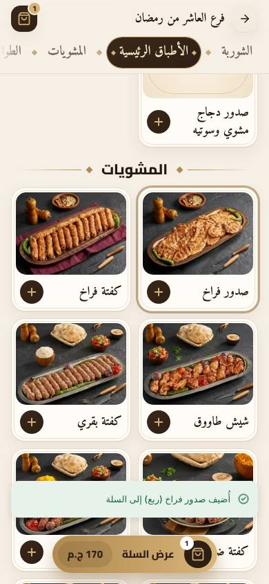

### UX-16
**صفحات بلا منطقة main وشريط تجريبي خارج المناطق**

- **الصفحة:** إتمام الطلب / الطلب / التتبع
- **العنصر:** بنية الصفحة
- **الوصف:** صفحات الشريط الغامق لا تحتوي عنصر main، فلا يستطيع قارئ الشاشة القفز للمحتوى.
- **الدليل:** axe: landmark-one-main وregion على 9 حالات؛ Lighthouse إمكانية الوصول 98 للتتبع.
- **لقطة الشاشة:** `screenshots/evidence/track-no-main-landmark.jpg`
- **السبب المحتمل:** مكون BandSheet عنصر div.
- **التأثير على المستخدم:** تنقل أبطأ لمستخدمي قارئات الشاشة.
- **الحل المقترح:** جعل BandSheet عنصر main، ووضع الشريط التجريبي داخل header.
- **الأولوية:** متوسطة
- **المصدر:** axe-core وLighthouse

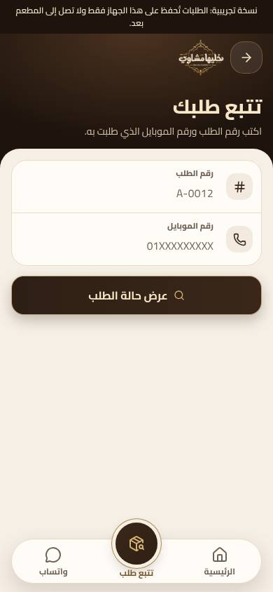

## منخفضة

### UX-17
**ضغطة Tab بعد حقل المنطقة تضيع**

- **الصفحة:** إتمام الطلب
- **العنصر:** حقل المنطقة
- **الوصف:** بعد حقل المنطقة يذهب التركيز إلى لا شيء، ثم يصل للشارع في الضغطة التالية.
- **الدليل:** اختبار لوحة المفاتيح: الترتيب «المنطقة ← (لا شيء) ← الشارع».
- **لقطة الشاشة:** لا توجد (نتيجة اختبار لوحة المفاتيح أو قياس)، انظر `results/`
- **السبب المحتمل:** عنصر يأخذ التركيز ثم يختفي عند قفل قائمة المناطق.
- **التأثير على المستخدم:** ارتباك بسيط لمستخدم لوحة المفاتيح.
- **الحل المقترح:** إزالة العنصر من ترتيب Tab أو نقل التركيز للشارع.
- **الأولوية:** منخفضة
- **المصدر:** اختبار لوحة المفاتيح

### UX-18
**اللوحة تفتح على «جديد» فتختفي الطلبات الجارية**

- **الصفحة:** لوحة الكول سنتر
- **العنصر:** فلتر الحالة الافتراضي
- **الوصف:** الطلب الذي يُجهَّز أو خرج للتوصيل لا يظهر عند فتح اللوحة؛ يحتاج الموظف لتغيير الفلتر.
- **الدليل:** عند فتح اللوحة ببيانات 3 طلبات يظهر طلب واحد فقط (جديد)؛ اختبار F41 احتاج لاختيار «الكل» أولاً.
- **لقطة الشاشة:** `screenshots/evidence/admin-default-filter-new.jpg`
- **السبب المحتمل:** الفلتر الافتراضي «جديد».
- **التأثير على المستخدم:** قد يغفل الموظف عن طلبات جارية متأخرة.
- **الحل المقترح:** عرض عدد الطلبات الجارية بشكل بارز، أو جعل الافتراضي «جديد + جاري».
- **الأولوية:** منخفضة
- **المصدر:** الاختبار الوظيفي

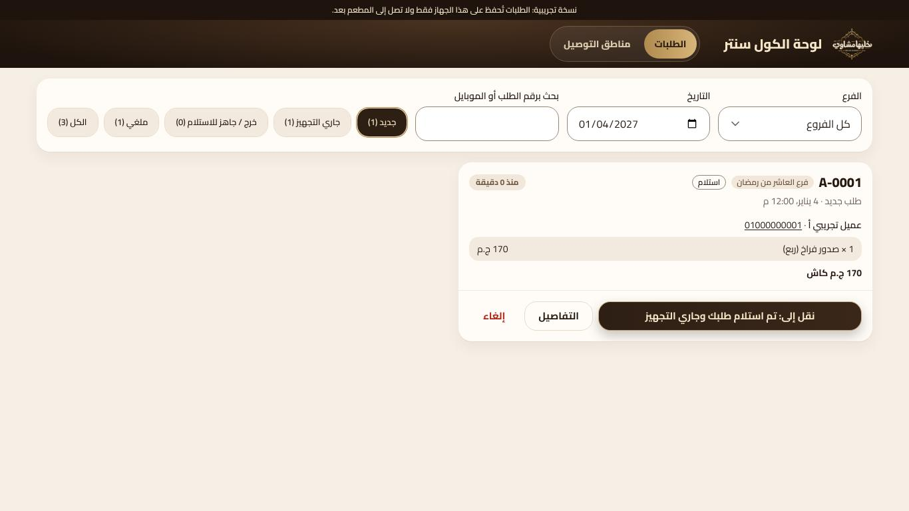

### UX-19
**التاريخ يظهر بالصيغة الأمريكية**

- **الصفحة:** لوحة الكول سنتر
- **العنصر:** حقل التاريخ
- **الوصف:** 4 يناير يظهر «01/04/2027» (شهر/يوم)، فيُقرأ أول أبريل.
- **الدليل:** لقطة 1366 للوحة.
- **لقطة الشاشة:** `screenshots/evidence/admin-date-format.jpg`
- **السبب المحتمل:** حقل التاريخ الأصلي يتبع لغة المتصفح لا لغة الصفحة.
- **التأثير على المستخدم:** خطأ محتمل في فلترة الطلبات بالتاريخ.
- **الحل المقترح:** عرض التاريخ المختار بالعربية بجانب الحقل، أو أزرار «اليوم/أمس».
- **الأولوية:** منخفضة
- **المصدر:** الفحص البصري

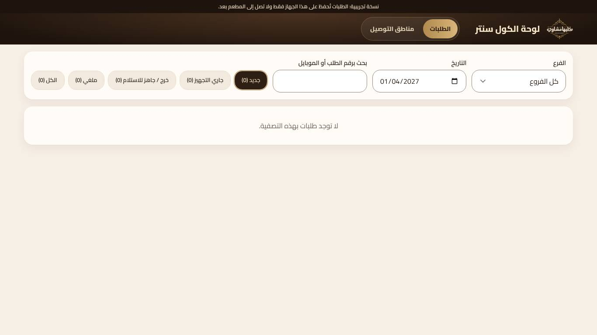

### UX-20
**إطار التركيز على الكارت باهت**

- **الصفحة:** المنيو
- **العنصر:** كروت الأصناف
- **الوصف:** عند التنقل بلوحة المفاتيح يظهر إطار ذهبي شفاف 50٪ بعرض 3 بكسل على خلفية كريمي.
- **الدليل:** لقطة التركيز: الإطار موجود لكن ضعيف الوضوح.
- **لقطة الشاشة:** `screenshots/evidence/focus-card-ring.jpg`
- **السبب المحتمل:** لون الحلقة ring/50.
- **التأثير على المستخدم:** صعوبة معرفة الصنف المحدد.
- **الحل المقترح:** حلقة بني داكن كاملة اللون.
- **الأولوية:** منخفضة
- **المصدر:** اختبار لوحة المفاتيح

### UX-21
**أزرار أصغر من 44 بكسل**

- **الصفحة:** صفحة الطلب / نافذة الصنف / المنيو
- **العنصر:** أزرار صغيرة
- **الوصف:** نسخ الرقم ومشاركته 38×38، مسح البحث 40×40، حذف الملاحظة 45×28، عداد الكمية في نافذة الصنف 42×42.
- **الدليل:** مقياس مساحة اللمس الفعلية على 5 مقاسات. كلها أكبر من حد WCAG AA (24) وأصغر من التوصية 44.
- **لقطة الشاشة:** `screenshots/evidence/small-copy-share.jpg`
- **السبب المحتمل:** مقاسات أيقونات ثابتة.
- **التأثير على المستخدم:** ضغطات خاطئة على الشاشات الصغيرة.
- **الحل المقترح:** مساحة لمس 44 بكسل بعنصر وهمي دون تغيير الشكل.
- **الأولوية:** منخفضة
- **المصدر:** الفحص الآلي للمس

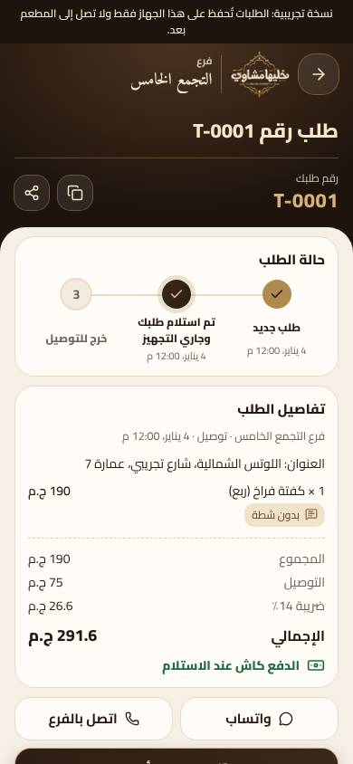

### UX-22
**نصوص بحجم 11 إلى 11.5 بكسل**

- **الصفحة:** عدة صفحات
- **العنصر:** نصوص صغيرة
- **الوصف:** عناوين الحقول، والتواريخ، وعداد الملاحظة، وجملة «بالحجز المسبق قبل 24 ساعة»، وكلمة «فرع».
- **الدليل:** مقياس الخطوط: 99 عنصراً بحجم 11 بكسل عبر كل اللقطات.
- **لقطة الشاشة:** `screenshots/evidence/small-labels.jpg`
- **السبب المحتمل:** اختيار مقاسات صغيرة للنصوص الثانوية.
- **التأثير على المستخدم:** صعوبة القراءة لكبار السن.
- **الحل المقترح:** حد أدنى 12 بكسل للنص الثانوي و13 لعناوين الحقول.
- **الأولوية:** منخفضة
- **المصدر:** الفحص البصري الآلي

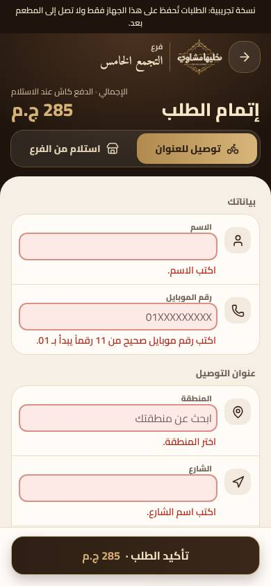

### UX-23
**رسالة الإضافة بخط النظام لا بخط الموقع**

- **الصفحة:** المنيو
- **العنصر:** رسالة «أُضيف…»
- **الوصف:** رسالة التأكيد تستخدم ui-sans-serif بينما كل الموقع بخط Cairo.
- **الدليل:** مقياس الخطوط: ui-sans-serif في حالة «بعد إضافة صنف» فقط.
- **لقطة الشاشة:** `screenshots/evidence/toast-font.jpg`
- **السبب المحتمل:** مكتبة الرسائل sonner تحدد خطها.
- **التأثير على المستخدم:** عدم اتساق بصري بسيط.
- **الحل المقترح:** تمرير خط الموقع لمكون الرسائل.
- **الأولوية:** منخفضة
- **المصدر:** الفحص البصري الآلي

### UX-24
**الخلفية المتدرجة بلا لون احتياطي**

- **الصفحة:** إتمام الطلب / الطلب / التتبع
- **العنصر:** الشريط الغامق
- **الوصف:** أدوات الفحص (pa11y) تقرأ النص الكريمي على خلفية الصفحة الفاتحة لأن الشريط بلا لون خلفية صريح.
- **الدليل:** pa11y أبلغ عن 5 مشاكل تباين؛ القياس الفعلي 9.7:1 إلى 14.8:1 (ناجح). axe الأحدث صنّفها «تحتاج مراجعة».
- **لقطة الشاشة:** `screenshots/evidence/track-no-main-landmark.jpg`
- **السبب المحتمل:** خلفية radial-gradient فقط.
- **التأثير على المستخدم:** لا أثر على المستخدم؛ يربك أدوات الفحص والتقارير.
- **الحل المقترح:** إضافة background-color بني داكن تحت التدرج.
- **الأولوية:** منخفضة
- **المصدر:** pa11y-ci

### UX-25
**قفزة تخطيط في اللوحة على الموبايل**

- **الصفحة:** لوحة الكول سنتر
- **العنصر:** رسالة «لا توجد طلبات»
- **الوصف:** CLS = 0.108 (الحد 0.1) لأن رسالة الحالة الفارغة تظهر بعد التحميل.
- **الدليل:** Lighthouse admin-mobile: CLS 0.108، والعنصر المتسبب p.rounded-[20px].
- **لقطة الشاشة:** `screenshots/evidence/admin-cls.jpg`
- **السبب المحتمل:** اللوحة تُحمّل كسولاً ثم ترسم المحتوى.
- **التأثير على المستخدم:** بسيط؛ شاشة موظفين.
- **الحل المقترح:** حجز ارتفاع ثابت لمنطقة القائمة أثناء التحميل.
- **الأولوية:** منخفضة
- **المصدر:** Lighthouse

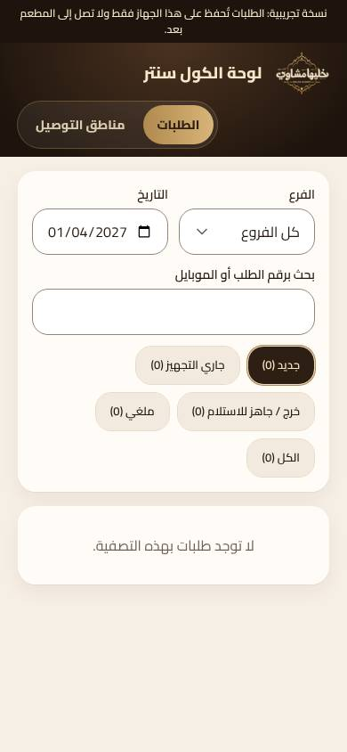

### UX-26
**صور لوجو أكبر بكثير من حجم عرضها**

- **الصفحة:** اللوحة / 404
- **العنصر:** اللوجو
- **الوصف:** اللوجو الذهبي 560 بكسل يُعرض بعرض 60، واللوجو الفاتح 530 يُعرض بعرض 124.
- **الدليل:** مقياس الصور: 290 حالة عرض بصورة أكبر من 2.5 ضعف حجمها.
- **لقطة الشاشة:** لا توجد (نتيجة اختبار لوحة المفاتيح أو قياس)، انظر `results/`
- **السبب المحتمل:** ملف واحد لكل المقاسات.
- **التأثير على المستخدم:** بضع عشرات KB زائدة.
- **الحل المقترح:** نسخة 160 بكسل للهيدر الصغير.
- **الأولوية:** منخفضة
- **المصدر:** الفحص الآلي للصور

### UX-27
**مساحات فارغة كبيرة على شاشات 1920**

- **الصفحة:** الرئيسية وغيرها
- **العنصر:** عرض المحتوى
- **الوصف:** المحتوى بعرض أقصى 1240 بكسل في المنتصف، فيبقى ثلث الشاشة فارغاً على الجانبين، والرئيسية صغيرة بالنسبة للشاشة.
- **الدليل:** لقطات 1920 لكل الصفحات.
- **لقطة الشاشة:** `screenshots/evidence/desktop-1920-empty-space.jpg`
- **السبب المحتمل:** حد أقصى للعرض مناسب لـ1366.
- **التأثير على المستخدم:** شكلي؛ أغلب العملاء على الموبايل.
- **الحل المقترح:** زيادة العرض الأقصى أو حجم البطاقات من 1600 بكسل.
- **الأولوية:** منخفضة
- **المصدر:** الفحص البصري

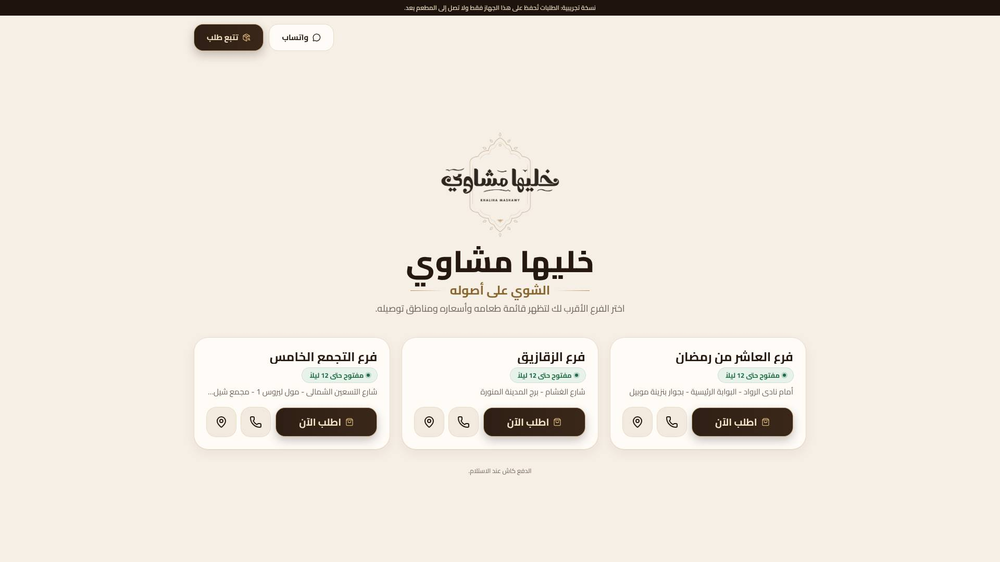

### UX-28
**عنوان فرع التجمع مقصوص في كل المقاسات**

- **الصفحة:** الرئيسية
- **العنصر:** عنوان فرع التجمع
- **الوصف:** «شارع التسعين الشمالي - مول ليروس 1 - مجم…»؛ العنوان الكامل في الخريطة فقط.
- **الدليل:** مقياس النص المقصوص في الرئيسية على كل المقاسات.
- **لقطة الشاشة:** `screenshots/evidence/address-truncated.jpg`
- **السبب المحتمل:** العنوان في سطر واحد.
- **التأثير على المستخدم:** بسيط؛ العميل يحتاج العنوان الكامل للاستلام.
- **الحل المقترح:** سطران للعنوان أو إظهاره كاملاً عند الضغط.
- **الأولوية:** منخفضة
- **المصدر:** الفحص البصري الآلي

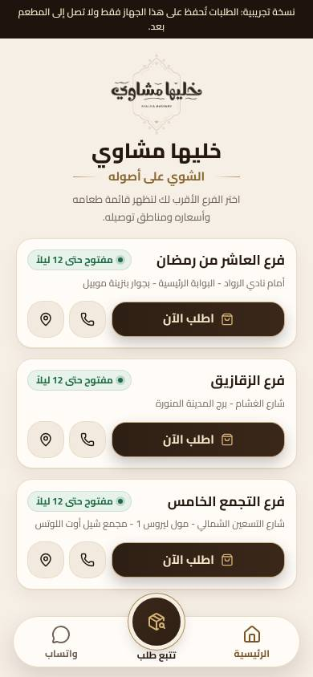

### UX-29
**لا يمكن الطلب المسبق والفرع مغلق**

- **الصفحة:** السلة / إتمام الطلب
- **العنصر:** الفرع المغلق
- **الوصف:** العميل يجهز السلة لكن زر إتمام الطلب معطل حتى يفتح الفرع؛ لا يوجد «اطلب لاحقاً».
- **الدليل:** اختبارا F18 وF28: الزر معطل مع رسالة «يفتح 11 صباحاً». الوصول للإتمام فقط برابط مباشر.
- **لقطة الشاشة:** `screenshots/m390/cart-closed.jpg`
- **السبب المحتمل:** قرار تشغيلي: لا طلبات خارج المواعيد.
- **التأثير على المستخدم:** خسارة طلبات الليل المتأخر والصباح الباكر.
- **الحل المقترح:** (يحتاج قرار المالك) جدولة الطلب لوقت الفتح، أو الإبقاء مع زر «ذكّرني».
- **الأولوية:** منخفضة
- **المصدر:** الاختبار الوظيفي

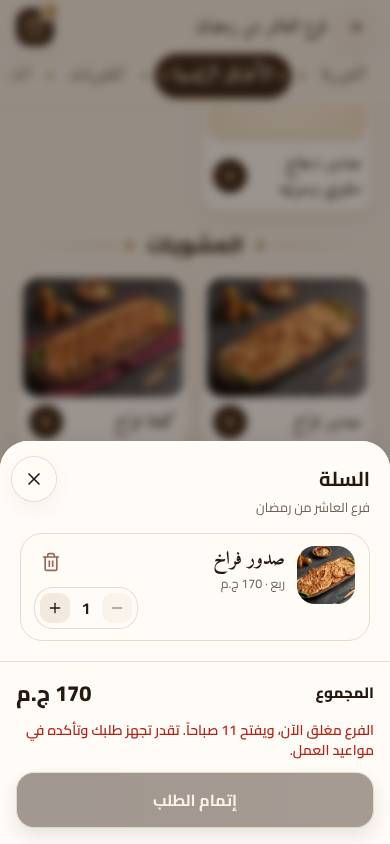

## اقتراحات تصميمية (ليست مشاكل)

- **ترتيب الأقسام:** المنيو يبدأ بالشوربة بقرار المالك. الزائر الجديد الذي يبحث عن المشويات (الشخصية 1) استخدم شريط الأقسام. ليس خطأً؛ يمكن قياسه لاحقاً بعدد الطلبات من كل قسم.
- **أصناف بلا صورة (43):** تظهر بأيقونة ذهبية متسقة مع الهوية. إضافة صورها تزيد الشهية.
- **وسم «الأكثر طلباً»:** مفيد للمستخدم المعتاد على التطبيقات (الشخصية 5)، والآلية موجودة في الكود (شارات من ملف البيانات).
- **صفحة «كيف نعمل»:** الدفع كاش، ومن يتصل، ووقت التوصيل، وسياسة الإلغاء في مكان واحد.
